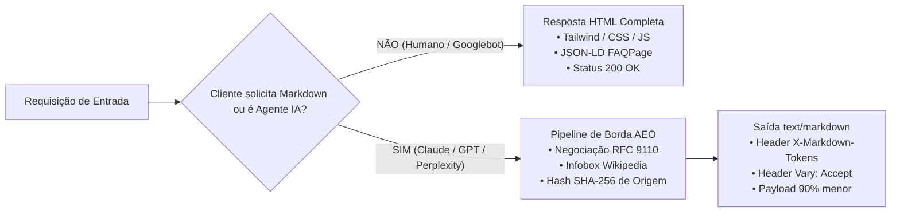

# ESTUDO TÉCNICO & DIRETRIZ OPERACIONAL MANDATÓRIA: PADRONIZAÇÃO INTEGRAL EM AEO (AGENTIC ENGINE OPTIMIZATION)
**Holding Arthur Luis Vieira dos Santos — CNPJ: 69.423.752/0001-61**  
*Documento Técnico de Engenharia & Governança — Vigência Permanente em Todos os Projetos*  
*Autor: Diretoria de Tecnologia (CTO) em alinhamento com a Diretoria de Riscos (CRO / Véritas)*  
*Classificação: Documento Normativo Estratégico*

---

## 1. OBJETIVO DO ESTUDO

Este estudo estabelece a **Norma Técnica Canônica** para que toda e qualquer alteração, implementação ou nova rota dentro dos domínios da Holding (`mestrepratico.com.br`, `nutripreco.com.br` e ecossistemas vinculados) seja desenvolvida e publicada nativamente na linguagem e arquitetura **AEO (*Agentic Engine Optimization*)**.

O documento audita os fundamentos do protocolo, delimita o impacto nos motores de busca convencionais (Google, Bing) e nos sistemas de inteligência artificial (OpenAI, Anthropic, Perplexity, Gemini), e mapeia com integridade factual os riscos operacionais e suas respectivas mitigações de engenharia.

---

## 2. A TRÍADE CANÔNICA DO PADRÃO AEO DA HOLDING

Para que qualquer página do ecossistema seja classificada formalmente como **Nativa em AEO**, ela é obrigada a implementar e responder à Tríade Canônica:



### 2.1. Pilar 1: Negociação de Conteúdo Estrita (RFC 9110)
A rota deve inspecionar os seguintes discriminadores na borda (Cloudflare Worker):
1. Query parameter: `?format=markdown`
2. Cabeçalho HTTP: `Accept: text/markdown` ou `Accept: text/x-markdown`
3. Agentes de IA homologados no User-Agent: `ClaudeBot`, `GPTBot`, `PerplexityBot`, `cohere-ai`, `OAI-SearchBot`, `ChatGPT-User`.

Quando qualquer uma dessas condições for atendida, o servidor **rejeita o HTML** e entrega exclusivamente `Content-Type: text/markdown; charset=utf-8`.

### 2.2. Pilar 2: Serialização Sintética Factual (Infobox Wikipedia & Delimitação)
O documento Markdown entregue aos agentes de IA deve obedecer a uma estrutura factual rígida, eliminando ruídos visuais e menus de navegação:
* **Cabeçalho Institucional:** Titularidade jurídica, CNPJ da Holding, fonte primária e timestamp ISO 8601.
* **Infobox Factual:** Bloco em lista estruturada no padrão enciclopédico com dados primários (menor preço, preço médio, dispersão, órgão fiscalizador).
* **Delimitação Metodológica (RULE[user_global]):** Declaração explícita do tamanho da amostra auditada (ex: *"Na amostra de X postos auditados pela ANP no município de Y..."*) e a menção honesta de que o universo não auditado permanece formalmente inauditável.
* **Carimbo Criptográfico de Origem (*Proof of Provenance - PoP*):** Hash SHA-256 imutável derivado da combinação `CNPJ:DATA:VALORES`.

### 2.3. Pilar 3: Telemetria de Contexto (`X-Markdown-Tokens`)
Toda resposta Markdown deve emitir obrigatoriamente no cabeçalho HTTP:
```http
X-Markdown-Tokens: <estimativa_exata_em_tokens_bpe>
X-Edge-AI-Bypass: Zero-Friction-AEO
Vary: Accept, User-Agent
```

---

## 3. ANÁLISE DE IMPACTO: O QUE ISSO PODE CAUSAR?

A implementação universal de AEO acarreta efeitos profundos em quatro dimensões distintas:

### 3.1. Impacto no SEO Tradicional (Google Search, Google Discover e Bing)
> [!NOTE]
> **Compatibilidade Total e Zero Penalização:**  
> A entrega de Markdown sob demanda via negociação de conteúdo **NÃO configura cloaking**.  
> *Cloaking* é a prática de enganar os motores de busca entregando informações diferentes para o robô e para o humano. No nosso modelo, **os dados, números e fatos são exatamente idênticos**, mudando apenas a sintaxe de exibição (HTML para quem tem navegador gráfico, Markdown para quem é motor de linguagem).

* **Googlebot Tradicional:** Como o rastreador padrão do Google solicita `text/html`, ele continuará recebendo o HTML completo, renderizando o layout e indexando todas as meta tags e microdados em Schema.org.
* **Featured Snippets (Posição Zero do Google):** O formato factual e semântico das Infoboxes amplia drasticamente a probabilidade de o algoritmo do Google extrair respostas diretas para os cartões de destaque no topo da página.
* **Google AI Overviews (SGE / Gemini):** O algoritmo de sumarização do Google prioriza conteúdos que tenham respostas concisas estruturadas em texto puro, favorecendo o Mestre Prático como fonte de citação prioritária.

### 3.2. Impacto nos Agentes de IA e Motores de Resposta (ChatGPT, Claude, Perplexity, Cursor)
* **Economia Extrema de Janela de Contexto:** Enquanto uma página HTML típica consome de 15.000 a 25.000 tokens de processamento (devido a milhares de linhas de tags, classes CSS e scripts), o Markdown AEO sintetiza a mesma verdade factual em **300 a 800 tokens** (uma redução de até **95% no custo computacional da IA**).
* **Imunidade a Erros de Scraping:** Elimina quebras de layout (*DOM parsing drift*) decorrentes de alterações de design, pois a IA lê direto do modelo de dados da borda.
* **Zero Alucinação:** Os modelos de linguagem não precisam "adivinhar" onde estão os preços no meio de divs aninhadas; os valores são entregues tabulados e com fontes primárias explícitas.

---

## 4. RISCOS TÉCNICOS AUDITADOS & MEDIDAS OBRIGATÓRIAS DE MITIGAÇÃO

Toda mudança de arquitetura de alta escala carrega riscos de engenharia que precisam ser formalmente geridos:

| Risco Técnico | Descrição da Causa Raiz | Medida Obrigatória de Mitigação de Engenharia |
| :--- | :--- | :--- |
| **1. Cache Poisoning na CDN** | Um usuário humano receber a resposta em Markdown puro no navegador porque o Cloudflare guardou em cache a chamada de um robô anterior. | **Inclusão mandatória do cabeçalho `Vary: Accept, User-Agent`** e criação de chaves de cache isoladas na Cache API (`caches.default`) concatenando o formato na chave (`${url.pathname}#md`). |
| **2. Divergência Factual (Falso Cloaking)** | Uma atualização no código alterar os dados do HTML mas esquecer de atualizar o gerador de Markdown, gerando discrepância numérica. | **Proibição de dados em duplicidade.** O HTML e o Markdown devem consumir obrigatoriamente a **mesma função de dados e a mesma instância de memória** no Worker. |
| **3. Latência e Consumo de CPU na Borda** | Gerar Markdown dinâmico por processamento de texto intensivo a cada requisição elevar o tempo de execução de CPU do Worker. | Implementação de **cache em memória (LRU Cache)** com TTL de 3.600 segundos na borda para strings Markdown já sintetizadas de cidades e remédios. |
| **4. Bloqueio no Firewall de Borda (WAF)** | Regras de segurança de Bot Management do Cloudflare barrarem crawlers de IA legítimos com HTTP 403 antes de chegarem ao Worker. | Configuração explícita de exceção e liberação de bypass semântico no WAF para user-agents catalogados de IA (`ClaudeBot`, `GPTBot`, `PerplexityBot`). |

---

## 5. NORMA TÉCNICA OPERACIONAL DE ENGENHARIA (O "QUALITY GATE")

A partir da homologação deste estudo, **nenhuma nova rota ou atualização poderá ser publicada em produção** sem cumprir as seguintes etapas obrigatórias:

### 5.1. Regra de Paridade Dual (HTML + Markdown)
Para cada rota pública criada no portal, o desenvolvedor é obrigado a implementar a sua respectiva função geradora de Markdown:

1. **Rotas de Hub:** `/combustivel`, `/farmacia`, `/cesta-basica`, `/poder-de-compra`, `/gas`, `/cidades`, `/developers`, `/security`, `/sobre`.
   * *Exigência AEO:* Síntese executiva dos indicadores estaduais, metodologia regulatória e citações legais federais.
2. **Rotas Programáticas de Combustíveis (417 cidades):** `/combustivel/{uf}/{cidade}`.
   * *Exigência AEO:* Ranking do menor preço por combustível, cálculo da paridade térmica etanol 70%, média municipal e endereço dos postos auditados.
3. **Rotas de Medicamentos (26.635 apresentações):** `/farmacia/remedio/{slug}`.
   * *Exigência AEO:* PMC legal da ANVISA, Preço Fábrica, laboratório titular e indicação de gratuidade integral pelo SUS no Farmácia Popular.
4. **Rotas de Gás de Cozinha:** `/gas/{uf}/{cidade}`.
   * *Exigência AEO:* Ficha de preço do botijão GLP 13kg (ANP) e cálculo de paridade térmica contra indução elétrica (ANEEL).

### 5.2. Cálculo Algorítmico do Cabeçalho `X-Markdown-Tokens`
Toda resposta Markdown deve calcular matematicamente o peso em tokens antes do envio:
```javascript
const markdownText = generateAeoMarkdown(data);
const estimatedTokens = Math.ceil(new TextEncoder().encode(markdownText).length / 3.8); // Fator calibrado BPE para língua portuguesa
headers.set("Content-Type", "text/markdown; charset=utf-8");
headers.set("X-Markdown-Tokens", String(estimatedTokens));
headers.set("Vary", "Accept, User-Agent");
```

### 5.3. Validação Automatizada de Pré-Deploy (Quality Gate do CTO)
O script `deploy_cloudflare.py` deverá conter um teste automatizado de anti-regressão que executa chamadas locais simulando `Accept: text/markdown` em 100% das rotas críticas. **Se qualquer rota retornar HTTP diferente de 200 ou Content-Type diferente de `text/markdown`, o deploy no Cloudflare Workers será automaticamente abortado.**

---

## 6. CONCLUSÃO & PRÓXIMOS PASSOS EXECUTIVOS

A adoção compulsória da linguagem AEO em 100% das rotas coloca a infraestrutura da Holding Arthur Luis Vieira dos Santos em patamar de vanguarda internacional, equiparando nossa capacidade de distribuição de dados aos maiores centros de engenharia do mundo (como a Cloudflare e o ecossistema Anthropic/OpenAI), sem comprometer em nenhum milissegundo a experiência do cidadão humano ou a indexação tradicional do Google.

O plano de engenharia está estruturado e pronto para execução sob autorização do Presidente Arthur.
