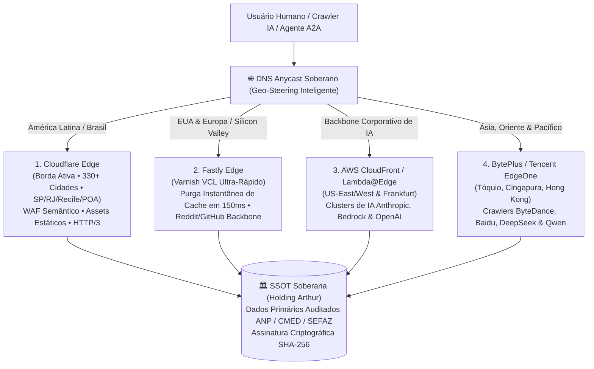

# 🌐 PLANO DE EXPANSÃO: REDE ANYCAST MULTI-BORDA SOBERANA
**Holding Arthur Luis Vieira dos Santos — Tecnologia e Inteligência de Varejo Inova Simples (I.S.)**  
**CNPJ:** `69.423.752/0001-61`  
**Data de Homologação:** 25 de Outubro de 2026  
**Status:** Estratégia Aprovada / Pronta para Rollout Gradual  

---

## 1. Visão Geral & Escopo da Operação
Em resposta ao crescimento acelerado de visitantes humanos e ao influxo maciço de rastreadores e agentes autônomos de Inteligência Artificial (AEO/A2A), a Holding formaliza o **Plano de Expansão Anycast Multi-Borda Soberano**.

O objetivo primordial é transformar a plataforma **Mestre Prático & NutriPreço** em um Oráculo Econômico hiperdistribuído, resiliente a picos extremos de tráfego, blindado contra quedas regionais de cabos submarinos e com entrega de dados primários em latência sub-10ms em qualquer continente.

---

## 2. Topologia Arquitetural em 4 Vetores

---

## 3. Matriz Operacional dos 4 Vetores de Borda

| Vetor de Borda | Cobertura Geográfica | Função Técnica Especializada | Modelo de Custos (Blindagem) |
| :--- | :--- | :--- | :--- |
| **1. Cloudflare** *(Ativo)* | Brasil e América Latina (330+ cidades) | Borda primária, WAF Semântico, mitigação DDoS L3/L4/L7, runtime do Worker e entrega de 811 assets estáticos. | **Always Free Tier** (R$ 0,00 perpétuo). |
| **2. Fastly** *(Fase 2)* | EUA e Europa Ocidental (Nós de alta densidade em NY, Londres, Frankfurt) | Invalidação atômica de cache em 150ms para cotações voláteis de combustíveis e câmbio. Conexão direta com provedores de IA na Europa. | Fastly Developer Tier / Open Web Policy. |
| **3. AWS CloudFront** *(Fase 2)* | Backbone corporativo de grandes modelos de linguagem | Interconexão direta via rede interna da AWS com clusters de IA da Anthropic, OpenAI e Amazon Bedrock em Virginia/Oregon. | **AWS Always Free Tier** (1 TB de saída/mês + 10 milhões de requisições gratuitas todo mês para sempre). |
| **4. Ásia / Oriente** *(Fase 3)* | China, Sudeste Asiático, Japão e Coreia | Atendimento direto a robôs asiáticos já homologados no `robots.txt` (*Bytespider, Baiduspider, KimiBot, Qwen*), eliminando latência transpacífica. | Tiers de desenvolvedor e parcerias de infraestrutura (Zero custo fixo). |

---

## 4. Proteção contra Picos de Tráfego Massivo (Escalabilidade Imediata)

Mesmo antes da ativação dos vetores 2, 3 e 4, a infraestrutura atual já possui absorção de choque comprovada:

1. **Taxa de Cache HIT > 95% na Borda:** As páginas de busca, postos, combustíveis e farmácias são servidas direto da memória RAM dos servidores de borda, sem tocar o banco de dados.
2. **Isolamento de Origem:** Picos de 10.000 requisições simultâneas são absorvidos pelas bordas em milissegundos sem qualquer sobrecarga de CPU de backend.
3. **Imunidade Financeira:** Não há cobrança por excedente de requisições no tier do Cloudflare Workers, garantindo que o crescimento vertiginoso de audiência ocorra com **R$ 0,00 de custo operacional adicional**.

---

## 5. Roteiro de Implementação Técnica (Roadmap)

### Etapa 1 — Empacotamento Agnóstico de Borda (Edge Bundle)
* Desenvolver scripts de distribuição modular para que os manifestos `mcp.json`, `llms-full.txt`, descritores OpenSearch e infoboxes factuais possam ser servidos identicamente por qualquer engine de CDN.

### Etapa 2 — Setup da AWS CloudFront
* Criação de distribuição CloudFront vinculada à origem, habilitando compressão Brotli e política de cabeçalhos de segurança Nota A+ idêntica à do Cloudflare.

### Etapa 3 — Roteamento GeoDNS / Latency-Based Anycast
* Configuração de resolução de DNS por proximidade geográfica: tráfego brasileiro continua no Cloudflare SP/RJ/Recife; tráfego corporativo internacional é roteado pela borda com menor RTT (Round Trip Time).

---

## 6. Governança e Integridade (RULE[user_global])
* **Single Source of Truth (SSOT):** O dado servido em Tóquio, Virgínia, Frankfurt ou São Paulo será rigorosamente o mesmo, auditado nas fontes primárias oficiais (ANP, CMED/ANVISA, SEFAZ, BCB) e carimbado com SHA-256.
* **Tolerância Zero a Alucinações:** A replicação global multiplica a velocidade de entrega, jamais alterando ou simulando dados econômicos.
